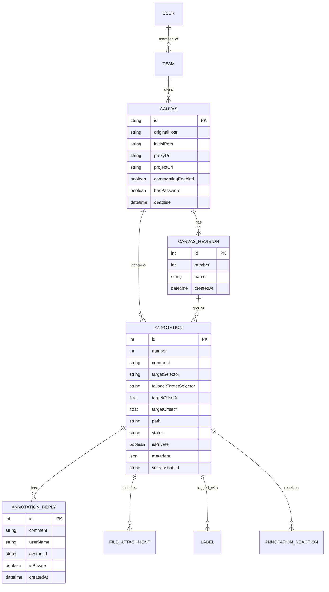

# Annotly — Product Overview & Reverse Engineering Analysis

## 1. Executive Summary

**Annotly** is an original website-feedback and visual collaboration SaaS designed for web agencies, developers, designers, and their clients. It enables reviewers to leave contextual, visual comments directly on live websites and web applications without requiring browser extensions, accounts, or complex onboarding.

This research document summarizes the architectural and behavioral investigation of the reference product (**Pastel**, `usepastel.com`), conducted using Reverse Engineering and Architecture (REA) methodologies. The analysis is grounded strictly in publicly observable runtime evidence, network behaviors, client bundle structures, and public documentation. No proprietary code, branding, or assets are copied.

---

## 2. Core Value Proposition & Problem Statement

### The Problem in Creative Web Feedback
Traditional website review workflows suffer from high friction:
- **Scattered Communication:** Clients send feedback via disparate channels—unformatted emails, Slack messages, spreadsheets, and annotated static screenshots.
- **Missing Technical Context:** Developers receive bug reports such as "this button is misaligned" without knowing the reviewer's screen resolution, browser version, operating system, or device pixel ratio.
- **Static vs. Live Disconnect:** Static screenshots (e.g., in Figma or InVision) cannot capture interactive states, hover effects, multi-page flows, animations, or responsive behavior on actual deployed code.
- **Client Onboarding Barrier:** Requiring non-technical clients to create accounts, remember passwords, or install browser extensions creates adoption resistance and slows down approvals.

### The Solution: Interactive Feedback Overlays
Pastel and Annotly solve this by introducing an interactive **Canvas**:
1. The project creator inputs a URL (staging, production, or prototype).
2. The platform generates a unique, persistent canvas URL (e.g., `annotly.com/review/[id]`).
3. The live website is rendered in an interactive viewport wrapped in a feedback toolbar and annotation layer.
4. Anyone with the link can point, click on any element, and leave an anchored comment pin.
5. The platform automatically attaches rich device and browser metadata, element selector paths, and a visual screenshot at the moment of comment creation.
6. The team manages, discusses, prioritizes, and resolves feedback in a centralized sidebar, or exports comments to project management tools.

---

## 3. High-Level Architectural Models

Based on observable evidence from the reference product and industry standards, there are three primary architectural models for web annotation tools:

| Model | How It Works | Advantages | Disadvantages |
| :--- | :--- | :--- | :--- |
| **Model A: Reverse Proxy (Reference Approach)** | A backend proxy fetches the target site, strips blocking headers (`X-Frame-Options`, `Content-Security-Policy`), rewrites internal URLs/assets, injects a lightweight client communication script, and serves it within an `<iframe>` under a dedicated proxy domain. | • Zero installation for reviewers • Works on any device/browser • Automatic live updates as target site changes | • Complex proxy rewriting • Cannot access localhost or VPN-protected sites without extension or tunnel • Heavy server bandwidth |
| **Model B: Embed Script (Widget Approach)** | Site owner pastes a `<script src="annotly.js">` into their site's `<head>`. | • Perfect rendering fidelity • Works on localhost, VPN, and staging • Zero proxy server overhead | • Requires code access / developer install • Cannot review 3rd-party sites or production without code push |
| **Model C: Browser Extension** | Reviewer installs an extension that injects the annotation UI directly into the active browser tab. | • Can comment on any site, including authenticated, localhost, and intranet sites • Direct access to full browser DOM | • High friction: requires installation • Browser-specific (Chrome/Edge only) • Does not work on mobile devices |

### Observed Reference Architecture (Pastel)
Runtime inspection reveals that Pastel employs a **hybrid approach**:
- **Primary:** Reverse Proxy (`*.proxy.usepastel.com`) serving an injected `<iframe>` inside the canvas web application.
- **Secondary / Fallback:** A companion Chrome Extension (`pastelExtensionExists` flag detected in client state) for environments behind VPNs, strict firewalls, or requiring complex local authentication.

---

## 4. Key Entities & Domain Concepts

Observable Redux state and API payload structures in the reference product reveal the following core domain entities:

### Definitions:
- **Canvas:** The primary container representing a reviewed website project. Has a persistent slug/ID, team ownership, access control, and settings.
- **Canvas Revision:** A discrete milestone or feedback cycle (e.g., "Revision 1", "Revision 2"). Allows freezing previous feedback rounds while collecting new feedback on a revised build.
- **Annotation (Pin):** An anchored feedback item placed at a specific DOM element and coordinate offset on a specific page path.
- **Annotation Reply:** A threaded response to an existing annotation.
- **Annotation Metadata:** Snapshot of reviewer environment: user-agent, browser name/version, OS name/version, screen width/height, device pixel ratio, and scroll position.
- **Status:** Feedback lifecycle state (`active`, `in-progress`, `in-review`, `resolved`).

---

## 5. Separation of Observable Facts vs. Assumptions

To adhere to REA guidelines, observed evidence is strictly distinguished from engineering inferences:

### Observable Facts (Direct Evidence)
1. **URL Structure:** Canvas links follow the pattern `usepastel.com/link/[id]`. Proxied content is requested through `[slug].proxy.usepastel.com/_domains/[tld]/[domain]/_url/[encoded_url]`.
2. **PostMessage Protocol:** The canvas host communicates with the proxied iframe using window messages with types `connect.app`, `initialize.app`, `update.app`, `path.change`, `annotation.new`, `annotation.element.positions.update`, and `screenshot`.
3. **Element-Relative Pin Coordinate Math:** Annotations store `targetSelector` (CSS selector string) and `targetOffsetX` / `targetOffsetY` as float percentages relative to the target element's bounding box.
4. **Metadata Schema:** Annotations store an object containing `ua`, `browser: { name, version, major }`, `engine`, `os`, and `window: { width, height, devicePixelRatio, pageXOffset, pageYOffset }`.
5. **Guest Reviewer Handling:** Non-authenticated users can drop pins without an account. On first submission, an inline prompt captures `userName` and `email`, generating an avatar via Gravatar fallback.
6. **Modes:** The canvas supports two exclusive operational states: **Comment Mode** (dropping pins) and **Browse Mode** (interacting with links and forms natively).
7. **Control Mechanisms:** Project owners can toggle "Pause Commenting" to place the canvas in read-only mode, or schedule automated feedback deadlines.

### Inferences & Engineering Assumptions
1. **Proxy Implementation:** The reference backend likely runs Node.js/Go proxy workers that parse HTML via streaming parsers, inject script tags before `</body>`, and replace relative URLs (`src`, `href`, `srcset`, `url(...)`).
2. **Screenshot Generation Pipeline:** Screenshots are captured either via an in-iframe HTML5 canvas rasterization script (or `html2canvas` variant) transmitted via data URL, or via a server-side headless browser queue (Puppeteer/Playwright) triggered upon comment creation.
3. **Real-Time Synchronization:** Presence and new comment broadcasts in the reference product utilize WebSockets or persistent SSE (Server-Sent Events) channels connected to the canvas ID room.

---

## 6. Strategic Takeaways for Annotly

1. **Prioritize Zero-Friction Guest Experience:** The primary driver of adoption is that clients never have to log in. Annotly must support seamless guest commenting with simple name/email capture stored in local storage and cookies.
2. **Robust Pin Anchoring:** Absolute coordinate pins fail as soon as screen size changes or elements reflow. Annotly must anchor pins to DOM elements using resilient selector generation and percentage offsets.
3. **Clear Mode Distinction:** Users easily get confused if clicking a link drops a pin instead of navigating. Annotly must have an unmistakable, prominent toggle between **Comment Mode** and **Browse Mode** with keyboard shortcut support (`Alt + C`).
4. **Clean Modern Design System:** Following Annotly's design standards (`DESIGN.md`), the UI must feel ultra-clean, snappy, and modern, using shadcn/ui components, subtle micro-interactions, responsive sidebars, and polished badge pin styling.
