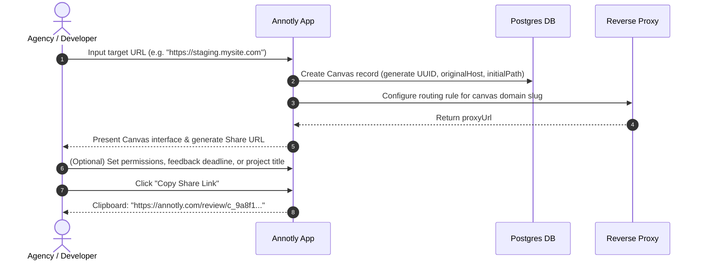
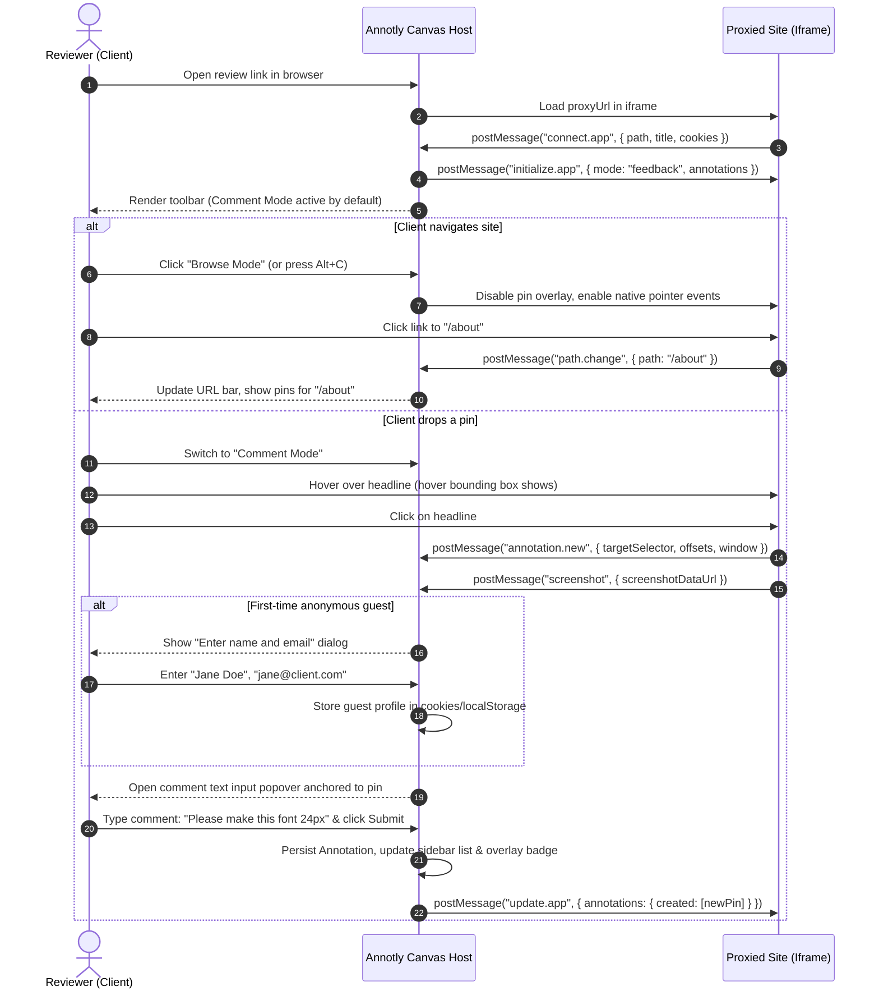
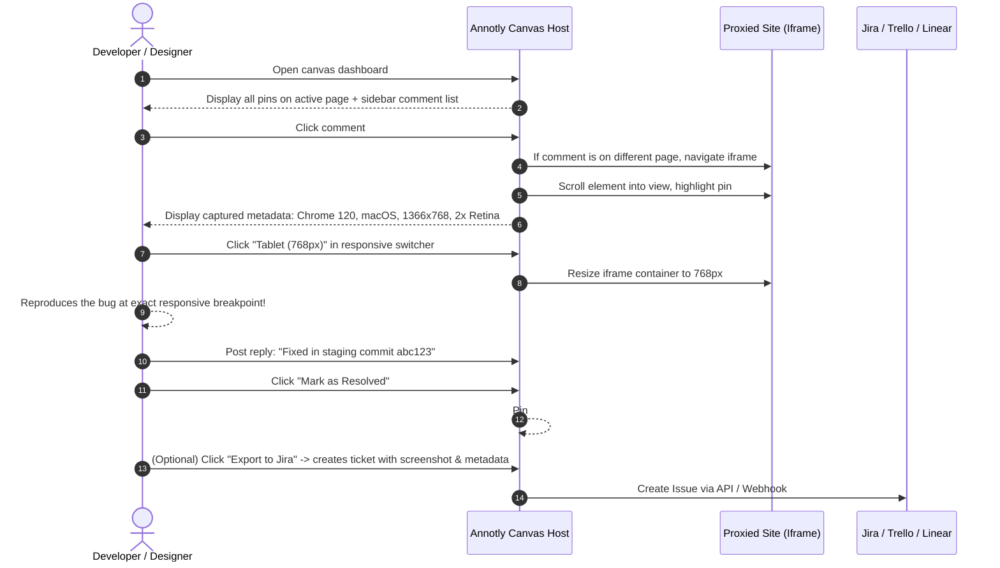

# Annotly — Review Workflow & Cross-Frame Protocol

This document details the complete end-to-end user workflows, lifecycle states, and the exact bidirectional messaging protocol between the host application and the embedded review frame, based on runtime evidence and architectural analysis of the reference product (**Pastel**).

---

## 1. End-to-End User Workflows

### 1.1 Canvas Creator Workflow (Agency / Developer)



1. **URL Entry:** The user provides any publicly accessible HTTP/HTTPS URL (production, Webflow, Shopify, staging server, Vercel preview URL).
2. **Project Initialization:** The platform creates a `Canvas` entity, computes an isolated subdomain proxy URL, and initializes "Revision 1".
3. **Sharing:** The creator copies a single, permanent review link and sends it to clients via Slack, email, or project management tools.

---

### 1.2 Reviewer Workflow (Client / External Stakeholder)



1. **Frictionless Entry:** The reviewer clicks the shared link. No sign-up, login, or extension install is requested.
2. **First-Run Welcome:** An optional tooltip or intro modal explains:
   - "Click anywhere to leave a comment."
   - "Use Browse Mode in the bottom toolbar to navigate between pages."
3. **Pin Placement:**
   - In Comment Mode, hovering over any element highlights its bounding box.
   - Clicking drops a temporary pin badge at the exact cursor position.
4. **Guest Profile Capture:**
   - If the user has no authenticated session or stored guest identity, an inline dialog prompts for Name and Email.
   - Subsequent comments automatically reuse this identity without re-prompting.
5. **Comment Submission:**
   - The user types their feedback, optionally attaches an image or selects a label (e.g., "Design", "Copy", "Bug"), and clicks Post.
   - The pin immediately turns into a numbered badge (e.g., `#1`), and appears in the sidebar comment stream.

---

### 1.3 Developer & Designer Triaging Workflow



1. **Centralized Review:** The developer opens the canvas and reviews the active pins.
2. **Context Inspection:** Clicking any comment card reveals:
   - The exact element highlighted on the live site.
   - Reviewer's screen dimensions, browser version, and OS.
   - The historical screenshot captured when the comment was created (verifying if recent code changes already altered the element).
3. **Responsive Verification:** The developer toggles between Desktop, Tablet, and Mobile viewport presets, or drags the viewport handle to match the reviewer's reported screen width.
4. **Resolution:** The developer replies to clarify, changes the status to `in-progress` or `resolved`, and closes the feedback loop.

---

### 1.4 Project Iteration & Milestone Revision Workflow

1. **Sprint / Phase Completion:** The agency completes fixes for all active feedback in "Revision 1".
2. **Pausing Feedback:** The project manager clicks "Pause Commenting" in canvas settings to prevent clients from leaving comments during server redeployments.
3. **New Revision Creation:**
   - The PM clicks "New Revision" (`isNewRevisionModalOpen`).
   - The system freezes Revision 1 (locking its comments as read-only historical records) and creates "Revision 2".
   - The canvas reloads with zero open pins for the new review cycle.
4. **Historical Comparison:**
   - At any time, team members or clients can use the Revision dropdown (`Revision 1 (14 comments)` vs. `Revision 2 (active)`) to review past feedback or audit decisions.

---

## 2. Cross-Frame Communication Protocol

Because the target website runs inside an `<iframe>` served from a proxy subdomain, cross-origin security restrictions prevent the parent canvas application from directly inspecting `iframe.contentDocument`. Communication must occur strictly via the HTML5 `window.postMessage` API using a structured, type-safe protocol.

### 2.1 Protocol Architecture

```
+-------------------------------------------------------------+
| Annotly Parent Window (Host App)                            |
| URL: https://annotly.com/review/[canvasId]                  |
|                                                             |
| - Manages UI toolbar, sidebar, responsive wrapper, presence |
| - Holds Redux/React state: annotations, users, modes        |
| - Renders floating pin overlays and comment popovers        |
+-------------------------------------------------------------+
           |                                  ^
           | postMessage                      | postMessage
           | (Parent -> Child)                | (Child -> Parent)
           v                                  |
+-------------------------------------------------------------+
| Iframe (Proxied Target Website)                             |
| URL: https://[slug].proxy.annotly.com/...                   |
| Injected Script: `annotly-client.bundle.js`                 |
|                                                             |
| - Inspects DOM on hover/click                               |
| - Generates element selectors and relative coordinate %     |
| - Observes element resize/scroll (ResizeObserver)           |
| - Captures visible screenshot / rasterization               |
| - Intercepts link clicks in Browse vs. Comment mode         |
+-------------------------------------------------------------+
```

---

### 2.2 Parent-to-Child Messages (`send(type, payload)`)

| Message Type | Direction | Payload Schema | Purpose & Trigger |
| :--- | :--- | :--- | :--- |
| `initialize.app` | Host $\rightarrow$ Frame | `{ annotations: Annotation[], user: UserProfile, deviceType: string, newAnnotationMode: string, selectedAnnotationId: number \| null, mode: "feedback" \| "view", canvasIsReadOnly: boolean, ignoreAnnotationHostname: boolean }` | Sent immediately after receiving `connect.app`. Bootstraps the injected script with existing pins, current mode, and read-only status. |
| `update.app` | Host $\rightarrow$ Frame | `{ annotations?: { created?: Annotation[], updated?: Annotation[], deleted?: Annotation[] }, canvasIsReadOnly?: boolean, urlToNavigateTo?: string, selectedAnnotationId?: number \| null }` | Incremental state broadcast. Sent whenever an annotation is created, resolved, or deleted, or when the user toggles Comment Mode or selects a pin in the sidebar. |

---

### 2.3 Child-to-Parent Messages (`listen(type, payload)`)

| Message Type | Direction | Payload Schema | Purpose & Trigger |
| :--- | :--- | :--- | :--- |
| `connect.app` | Frame $\rightarrow$ Host | `{ path: string, fullUrl: string, title: string, cookies?: any, credentials?: any }` | Fired when the injected script finishes loading in the iframe. Signals readiness and delivers the current page path, page title, and session metadata. |
| `path.change` | Frame $\rightarrow$ Host | `{ path: string, fullUrl: string, title: string }` | Fired when the reviewer navigates to a new page or changes client-side history state (`pushState`/`popstate`). Host updates URL bar and filters active pins to the new path. |
| `annotation.new` | Frame $\rightarrow$ Host | `{ targetSelector: string, fallbackTargetSelector: string \| null, targetOffsetX: float, targetOffsetY: float, path: string, fullUrl: string, metadata: { ua, browser, os, engine, window: { width, height, devicePixelRatio, pageXOffset, pageYOffset } }, textContentBefore?: string }` | Fired when the reviewer clicks on any DOM element while Comment Mode is active. Provides element selector and coordinate math. |
| `annotation.new.update` | Frame $\rightarrow$ Host | `{ textContentBefore: string, textContentAfter: string, targetSelector: string, ... }` | Fired when proposing inline copy/text edits. Automatically sets the comment text to `Change "[before]" to "[after]"`. |
| `screenshot` | Frame $\rightarrow$ Host | `{ screenshotDataUrl: string }` | Delivered following `annotation.new` with a base64 rasterized image of the viewport. |
| `annotation.element.positions.update` | Frame $\rightarrow$ Host | `{ annotationElementPositions: Record<number, { left: number, top: number, visible: boolean }> }` | Emitted on window resize or scroll. Delivers recalculated screen coordinates for every active pin so the parent overlay can reposition pin badges smoothly. |
| `annotation.active` | Frame $\rightarrow$ Host | `{ id: number }` | Fired when a previously missing element is found in the DOM and becomes visible. |
| `annotation.inactive` | Frame $\rightarrow$ Host | `{ id: number, inactiveReason: "element_not_found" \| "element_hidden" }` | Fired when the DOM element associated with `targetSelector` cannot be queried or has `display: none`. Host dims the pin or flags it in the sidebar. |
| `annotation.deselected`| Frame $\rightarrow$ Host | `{}` | Fired when clicking blank space away from an active pin or comment box. |
| `annotation.create.with.no.user` | Frame $\rightarrow$ Host | `{}` | Fired if an unauthenticated user attempts to place a pin, signaling the host to open `isGuestLoginModalOpen`. |
| `comment-mode.toggle` | Frame $\rightarrow$ Host | `{}` | Fired when the user presses keyboard shortcuts (`Alt+C`) inside the iframe. |
| `url.open-in-new-tab` | Frame $\rightarrow$ Host | `{ url: string, target: string, windowFeatures: string }` | Fired when a link pointing outside the proxied domain is clicked. Prevents breaking the iframe session and delegates opening to the parent window. |

---

## 3. Pin Coordinate Math & Overlay Repositioning

### The Calculation
Pins are not placed at fixed absolute pixel coordinates because websites reflow dynamically across different viewport widths and device displays. Instead, coordinates are stored as percentages of the targeted element's bounding rect:

```
                      Target Element Bounding Rect
  (rect.left, rect.top) +---------------------------------------+
                        |                                       |
                        |              Pin Offset               |
                        |      (targetOffsetX, targetOffsetY)   |
                        |                   X                   |
                        |                                       |
                        +---------------------------------------+ (rect.right, rect.bottom)
```

1. **On Click (Inside Iframe):**
   ```javascript
   const rect = targetElement.getBoundingClientRect();
   const targetOffsetX = ((clickEvent.clientX - rect.left) / rect.width) * 100;
   const targetOffsetY = ((clickEvent.clientY - rect.top) / rect.height) * 100;
   ```

2. **On Render / Resize (Parent Overlay):**
   The child iframe monitors element bounds via a `ResizeObserver` and scroll listener. When positions change, it calculates the element's current client rect and transmits it:
   ```javascript
   const pinAbsoluteX = rect.left + (rect.width * targetOffsetX) / 100;
   const pinAbsoluteY = rect.top + (rect.height * targetOffsetY) / 100;
   ```
   The parent overlays the pin badge at `iframe.offsetLeft + pinAbsoluteX`, `iframe.offsetTop + pinAbsoluteY`.

3. **Fallback Strategy:**
   If the element cannot be found (`document.querySelector(targetSelector)` returns null):
   - Try `fallbackTargetSelector` (parent container or tag-only selector).
   - If still not found, emit `annotation.inactive`. The parent displays the pin in the sidebar with an alert badge: *"Element changed or moved — view original screenshot"*.

---

## 4. Edge Cases, Timeouts, & Error Handling

| Edge Case | Failure Mode | Mitigation in Annotly |
| :--- | :--- | :--- |
| **Iframe Framebuster / X-Frame-Options** | Browser displays blank canvas or refuses to frame due to `X-Frame-Options: DENY` or CSP. | The Annotly reverse proxy intercepts HTTP headers and strips `x-frame-options`, `content-security-policy`, and `frame-ancestors` before serving to the client. |
| **Cross-Origin Asset Blocking (CORS)** | Fonts, SVGs, or CSS fail to render, causing layout breakage. | The reverse proxy rewrites asset URLs and injects `Access-Control-Allow-Origin: *` on proxied stylesheets and media. |
| **External Link Click** | User clicks an external link (e.g., social icon, Stripe checkout) that breaks the proxy context. | Injected script intercepts anchor clicks. External domains trigger `url.open-in-new-tab`, opening in a separate browser tab while keeping the canvas intact. |
| **Target Website Dynamic DOM Hydration** | In React/Next.js hydration, elements may re-render or change class names after initial load. | The injected script runs a `MutationObserver` and waits for hydration before anchoring pins. Selector generation prioritizes stable attributes (`id`, `data-testid`, semantic hierarchy) over generated class hashes. |
| **Proxy Gateway Timeout (504 / Target Down)** | Target server takes > 15 seconds or is unreachable. | Host renders a styled error state with diagnostic suggestions: "Unable to reach target server. Check URL, VPN, or firewall status." |
| **Stale Element on Revisions** | A website is updated and an annotated section is deleted. | The system always preserves the snapshot screenshot and metadata. The pin remains visible in the sidebar audit trail even if its DOM element is missing. |
